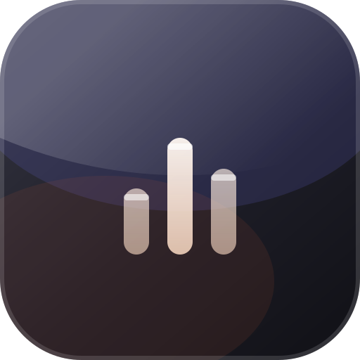

<div align="center">



<h2>SMod</h2>

<p>本地音乐播放器的桌面增强层 —— 自绘托盘菜单、独立歌词窗、液态玻璃皮肤。</p>

[](https://github.com/MMCKB/Smod/stargazers)
[](https://github.com/MMCKB/Smod/blob/main/LICENSE)
[](#)
[](https://www.electronjs.org/)

</div>

---

> [!NOTE]
> **非官方项目**，与 SPlayer-Next 的作者和团队没有任何关联。全部通过运行时注入实现，不改安装目录里的任何文件，关掉播放器就恢复原样。

## 特性

- 🪟 **自绘托盘菜单** — 接管托盘右键菜单，媒体键直接用播放器自带图标，二级菜单独立弹窗，菜单项可按需精简
- 🎤 **独立歌词窗** — 从菜单一键弹出，贴着菜单同尺寸显示；封面模糊背景、逐字填充、上下行景深，长句自动滚动
- ✨ **液态玻璃皮肤** — WebGL 实时折射，随时切回原生皮肤
- 📌 **任务栏歌词** — 贴在任务栏上的单行歌词
- 🧪 **Mod 实验室** — 注入到设置页的面板，开关改完即时生效
- 🪶 **零侵入** — 不修改 `app.asar`，不动安装目录里的任何文件

## 快速开始

> [!TIP]
> 目标机器**不用装 Node**。启动器把播放器自己的 exe 当 Node 运行时用。

```bash
git clone https://github.com/MMCKB/Smod.git
cd Smod
install.cmd
```

装完桌面和开始菜单会多一个「SPlayer Next」图标，从它启动即可。

安装目录不在默认位置时传入路径：`install.cmd "D:\APP\SPlayer-Next"`；双击 `uninstall.cmd` 还原。

> [!WARNING]
> 只支持 Windows 10 / 11。

## 配置

所有设置存在 `%APPDATA%\SMod\settings.json`，面板里的改动即时写入。删掉这个文件就回到默认。

## 许可

以 **GNU AGPL-3.0** 发布。

> [!CAUTION]
> 分发修改版必须同样以 AGPL-3.0 开放源码。**SMod 的名称与图标不随代码授权**，fork 请改名换图标。

不包含、不修改、不分发 SPlayer-Next 的任何代码或资源。第三方组件见 [THIRD_PARTY_NOTICES.md](THIRD_PARTY_NOTICES.md)。

## 已知边界

> [!IMPORTANT]
> 注入依赖播放器内部 DOM 结构，**版本升级后可能失效**。这是兼容性问题，不是功能承诺。

实现细节、调试方法和逐项验证记录见 [docs/internals.md](docs/internals.md)。

## 免责

> [!CAUTION]
> 本项目仅供个人学习与界面定制使用，与任何商业产品无关。
> 若你是本项目涉及的任一内容的权利人，认为此处存在侵权，请通过 [Issues](https://github.com/MMCKB/Smod/issues) 联系我，说明具体内容与权利依据，核实后会**立即删除相关部分或停止分发**。
> 项目不提供任何担保，使用产生的后果由使用者自行承担。
